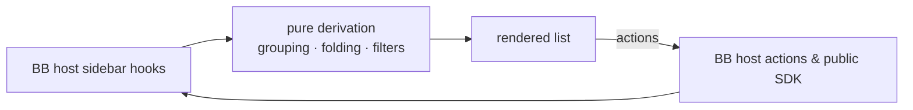

<div align="center">


# Radar Sidebar

### See which of your threads needs you, at a glance.

Radar replaces BB's sidebar thread list with a layout built
for people juggling dozens of agent threads at once.<br>
Grouping, folding and attention states do the sorting for you, so nothing that
needs a decision hides at the bottom of the list.


[Features](#features) · [Install](#install) · [Bot shortcuts](#navigation-and-bot-shortcuts) · [How it works](#how-it-works) · [Settings](#settings) · [Development](#development)

<br>


</div>

<br>

> [!NOTE]
> The screenshots are real BB captures populated with fictional demo data.

## The problem

You have forty agent threads open across six projects. Two are waiting for a
decision, one failed twenty minutes ago, and three finished while you were
somewhere else. BB's sidebar sorts them all the same way, so finding the ones
that need you is a manual sweep — and the moment you click a thread to look, it
jumps to the top of "Today" and you lose track of what was actually moving.

Radar is opinionated about the difference between *recent* and *important*.
Activity decides where a thread sits, not when you last opened it. Threads that
need something from you are impossible to miss, and threads that are simply
quiet get out of the way.

|  | Without Radar | With Radar |
| --- | :---: | :---: |
| Tell working from finished without reading | ❌ | ✅ distinct icon, word and colour per state |
| Opening a thread changes its group | ❌ it jumps to Today | ✅ grouping keys off real activity |
| See what a collapsed family is hiding | ❌ | ✅ count, unread rollup and loudest state |
| Spot a thread waiting for your input | ❌ | ✅ amber wash, bar and slow pulse |
| Tell which provider and model a thread runs | ❌ | ✅ icon, model and thinking on the row |
| Arrange the nav once for both surfaces | ❌ | ✅ shared with BB's own sidebar settings |

## Reading and notifications

Opening the displayed thread in a focused, visible client marks it read and reports presence. Radar never changes notification preferences. The matching bots core release uses steady coordinator input-only levels and sends finished-reply pushes itself, skipping open destinations while BB keeps questions, approvals and errors. See [behavior, mobile evidence and live checks](docs/thread-presence.md).

## Features

<table>
<tr>
<td width="50%" valign="top">

### 🛰️ Activity grouping

Threads group by Today, Yesterday, Previous 7 days, Previous 30 days or Older,
keyed off last *activity* — not last read. A thread you merely opened stays
where it belongs, and anything running or waiting surfaces to Today. Group by
project or section instead with the `grouping` setting. In section view, choose **New
section**, enter a name, then **Create section**. Drag threads onto its header
or use **Move to section** in a thread's right-click menu.

</td>
<td width="50%" valign="top">

### 🔴 One colour per meaning

**Blue** = running (a spinner, or one pulsing icon for background work),
**green** = done, **amber** = needs you, **red** = failed, **muted** =
queued (a clock: a message waiting behind a running turn) or held (a pause
icon and HELD: a message parked on an idle thread until you send it; held
threads are not live and stay out of the Working drawer). Running blue is
the plugin's own (BB's dark theme has no blue accent), mixed toward the
theme's text colour so it stays readable in light and dark. Project and
section chips only use hues outside red-to-amber, so a chip never looks like
a state. A leading status emoji in a bot's title (🟢 ✅ ❌ ⏳) is dropped from
the row, which already shows state in colour; tooltips keep the full title.
Group headers read "2 unread · 4", or just the total. A **tinted row** with a left bar means act on it: only needs-you
(amber) and failed (red) rows are tinted, and only they glow. Unread rows
just get a bold title, plus a blue pip when no DONE badge already says so.
Rows keep their height when their state changes, and hold their order while
your pointer or finger is on the list, so nothing moves under a click or tap.

</td>
</tr>
<tr>
<td valign="top">

### 🪢 Nested families

Child threads sit under their parent with indent guides, and the family sorts by
its freshest activity, so a running child floats its parent. Fold a family and
the summary tells you how many are hidden, how many are unseen, and the loudest
state inside.

</td>
<td valign="top">

### 🔎 Hover peek card

Pause on a row for a preview with the thread's original goal, its branch and
pull request, and a stacked context-window meter marked at the auto-compaction
threshold. It is interactive, so you can pin, split or archive from the card.

</td>
</tr>
<tr>
<td valign="top">

### 🧭 Navigation that follows BB

BB’s native rail owns destination order, visibility and More. Radar adds bot shortcuts within the thread list; there is no Crew destination.

</td>
<td valign="top">

### ⌨️ Keyboard and bulk control

Arrow keys walk the list, <kbd>Enter</kbd> opens, <kbd>Space</kbd> folds,
<kbd>E</kbd> archives, <kbd>P</kbd> pins and <kbd>X</kbd> selects. Shortcuts
stay out of text fields, open dialogs and menus, and buttons or links outside the
list, so they never steal keys from the rest of BB. <kbd>⌘</kbd>-click or <kbd>⇧</kbd>-click also selects several,
to act on them together from a floating dock. Swipe a row, by touch or with two fingers on a trackpad,
to mark it read or archive it; each direction's action is a setting. A swipe
starts only when the movement is clearly sideways, so a diagonal scroll stays
a scroll, and a finger must pull the row 40% of its width (at least 64px)
before the action arms. The **Waiting** filter shows threads that need you
(a question or approval), not held or queued messages.

</td>
</tr>
</table>

<div align="center">
<table>
<tr>
<td align="center"><br><sub><b>Attention states and nested families</b></sub></td>
<td align="center"><br><sub><b>Hover peek card</b></sub></td>
</tr>
<tr>
<td align="center"><br><sub><b>Grouped by project</b></sub></td>
<td align="center"><br><sub><b>Grouped by section</b></sub></td>
</tr>
<tr>
<td align="center"><br><sub><b>Status chips</b></sub></td>
<td align="center"><br><sub><b>Multi-select and bulk actions</b></sub></td>
</tr>
<tr>
<td align="center"><br><sub><b>Compact density</b></sub></td>
<td align="center"><br><sub><b>Right-click menu</b></sub></td>
</tr>
<tr>
<td align="center" colspan="2"><br><sub><b>Plugin settings</b></sub></td>
</tr>
</table>
</div>

## Install

```sh
bb plugin install 'git:https://github.com/MacHatter1/bb-plugin-radar-sidebar.git@^0.5.2' --yes
```

The Git semver range tracks compatible `v0.5.x` releases. If you installed
an earlier minor series, rerun this command to move to the new range.

Then choose **Radar** under **Settings → Appearance → Sidebar**. BB keeps its native navigation rail.

<details>
<summary><b>Install from a local clone</b></summary>

```sh
git clone https://github.com/MacHatter1/bb-plugin-radar-sidebar
cd bb-plugin-radar-sidebar
npm install && bb plugin build
bb plugin install path:$PWD --yes
```

</details>

**Requirements**

- bb **0.46+** with Plugin SDK **0.6.79+**

This fork (`salemsayed/bb-plugin-radar-sidebar`, 0.6.x) reaches Salem's bb only through `bb-deploy radar-sidebar`, which builds committed main.

## Where to find it

| Where | What |
| --- | --- |
| **Sidebar thread list** | Grouped, folded, attention-coloured threads with a filter, and one short view-options panel: status chips (Any, Live, Waiting, Unread, Pinned), **Archived** and **Hidden workers** toggles, and Collapse all / Expand all. |
| **Needs-you lane** | The one place for what waits on you: the bots’ saved asks, reminders and alerts (Done or Seen, Snooze, Undo, the bot’s recommended reply) above the threads waiting for an answer or approval. |
| **Native navigation rail** | BB destinations only. Bot shortcuts sit in Radar’s list header. |
| **Row hover** | A single ⋯ menu (pin, rename, archive and more); a peek card after a short pause. |
| **View options → Hidden workers** | Lists the worker threads a bot hid after relaying their result, dimmed with a “hidden” chip under their bot; their menu has **Show thread**, and a visible worker’s has **Hide**. bb’s sidebar feed leaves hidden threads out, so with this on Radar fetches them itself (`threads.list` with hidden threads included, per project in the feed and the bot roster) every minute, on window focus and right after Show thread or Hide; off, it fetches nothing. Hidden threads with no parent or owner are not workers and stay out. Off by default and remembered per client. |
| **Settings → Appearance** | Choose Radar for the thread list. |

## Navigation and bot shortcuts

BB owns the native navigation rail, destination order, More menu, footer and New thread control. Radar replaces only the thread list and follows BB's desktop and mobile navigation.

Enable **Bot shortcuts** (`botRail`) to show a compact row of bot faces above the filter. A face opens its current coordinator and shows that bot's workers. Tap the selected face again from its coordinator, or **All** at the start of the row, to show every thread. (BB's rail Home only switches the sidebar to this list; it does not clear the bot filter.) On desktop, hover or focus a face for the latest reply, worker state, context usage and links. Arrow keys traverse the faces; Escape closes details.

Bot state and unread badges retain their existing meaning. Hidden bots stay hidden unless they need attention; saved bot selection and visibility preferences are preserved. Turning shortcuts off restores the in-list deck. Existing `botRail` settings continue to work independently of the retired `railNav` and `wideRail` settings.

## Compatibility notes

SDK 0.6.33 removes the sidebar navigation replacement API. Radar no longer registers or imports it, and emits no CSS for BB's shell. Reminders remain native message and thread-panel actions; there is no Crew `navPanel` and no per-thread Attention panel. The old navigation and labelled-rail settings are retired, while BB keeps the user's destination arrangement.

Thread menus use BB's shared action registry, including per-thread notification settings and other plugins' actions. On mobile, menus and choices use BB's native drawers. Keyboard, swipe and bulk archive/delete actions keep BB's confirmation and Undo flows. This version requires SDK 0.6.37 and no longer uses the retired sidebar thread-action hook.

## How it works



- **Reads BB's live state, owns none of it.** Threads, projects and sections
  come from the host's sidebar hooks; pins, reads, renames and archives route
  through BB's own actions, so optimistic updates, confirmations and toasts
  behave exactly as they do in the stock list.
- **Derivation stays out of the components.** Grouping, tree building and
  filter matching live in one hook, `useThreadGroups`, and time bucketing is
  a plain function with no React, so the rows only render.
- **Model info is fetched, then cached per window.** The options endpoint
  resolves *defaults*, so model and thinking are shown only while a thread is
  actually in flight. Remounts within the same run reuse cached values;
  new activity, a restart or window focus triggers a refresh.
- **Large lists defer offscreen content.** Lightweight links preserve BB's
  shortcut order and keyboard navigation. Nearby rows render full controls;
  measured heights preserve spacing, and native archive/delete actions remain
  available for bulk selection. Offscreen model requests and gestures pause.
- **It will not move a thread between projects.** BB's thread API exposes no
  `projectId` on update, so project grouping is view-only; drag-to-organise
  files threads into sections, which BB does allow.

## Privacy

- 🛰️ **Nothing leaves the machine.** Radar makes no network requests of its own;
  every read and write goes to your BB server through the plugin SDK.
- 🧾 **Almost no storage of its own.** The plugin SQLite database holds only each
  thread's confirmed read point (`presence_read_point`). Preferences live in
  browser `localStorage`, except nav placement, which is BB's own synced state.
- 🔒 **No secrets.** The plugin defines no secret settings and reads none.

## Settings

`bb plugin config radar-sidebar`, or **Settings → Installed plugins → Radar Sidebar**.

<details>
<summary><b>All settings</b></summary>

| Setting | Default | |
| --- | --- | --- |
| `botRail` | `false` | Bot shortcuts and worker filtering in the list header. Off restores the in-list deck. |
| `botsPage` | `false` | Leave bot coordinators and workers out of the whole list, with no bot shortcuts, deck or saved bot asks. Overrides `botRail` and `botsDeck`. The Bots | Threads switch already keeps bot chats on Bots. |
| `botsSwitch` | `false` | A Bots \| Threads switch on top of the list and in the phone drawer, kept per device. Bots: a dispatch board from bb-salem-bots `bot_tasks` (tasks v2), with each bot **In motion** or **On call**; a bot's face and name open its chat, its right side opens its work panel (Chat · Automations · More, Tasks, Recent), and hold or right-click opens its coordinator's thread menu. Threads: every other thread, since bot chats and their workers stay on Bots; a typed filter is kept across the switch. Off: the list exactly as before. |
| `botsDeck` | `true` | Registered bot coordinators as cards at the top of the list, with their workers folded beneath; used while `botRail` is off. |
| `needsYouLane` | `true` | The Needs-you lane: one group above everything else for bot asks and threads waiting on you. |
| `nestByOwner` | `true` | A thread without a parent nests under the thread that owns its lifecycle, so plugin-run workers sit under their coordinator. |
| `hideEmptySections` | `false` | In section view, leave out sections with nothing shown; dragging onto a section still works while it has threads. |
| `hideWorking` | `false` | Move threads with work in flight into a folded **Working** drawer under the list. They come back when they finish or need you; pinned threads and the open thread stay put, and search or a status filter shows them in place. On desktop, hover the drawer's header to peek at every running thread: its latest words and step, todo progress, run time, context use, and flags for stalls, failing commands, a full context or a waiting question. |
| `hoverCard` | `true` | Show the hover peek card. |
| `celebrate` | `true` | Pop the check badge once when a thread finishes. |
| `motion` | `true` | Pulse rows that need input or have failed. Also respects `prefers-reduced-motion`. |
| `defaultDensity` | `"comfortable"` | **Row density**: `comfortable` or `compact` rows on a desktop. Touch screens always use compact rows. |
| `grouping` | `"time"` | **Group threads by**: `time` (last activity), `project`, or `section` (your own sections, with **New section** and drag to file). |
| `twoLineTitles` | `false` | Enable **Two-line titles** to wrap long titles, including mentions, before truncating. Short titles keep their project chip and time beside them when they fit; otherwise metadata wraps below, aligned with the title text. Applies in both densities. |
| `swipeActions` | `true` | Swipe a row left or right to act on it: one finger on a touch screen, two fingers on a trackpad. A swipe starts only once sideways travel passes 12px and 1.5× the vertical travel, and arms at 40% of the row (at least 64px); a quick flick commits only after the gesture has armed once. A trackpad swipe stopped short rests open with its action as a button. A mouse's clicks, drags and Shift+wheel are unaffected. |
| `swipeRight` | `"Mark read / unread"` | Action for a rightward swipe: `Mark read / unread`, `Pin / unpin`, `Archive / unarchive`, `Open in split`, `Rename`, `More actions`, `Delete…` (BB confirms) or `Nothing`. |
| `swipeLeft` | `"Archive / unarchive"` | Action for a leftward swipe, from the same list. |

**Archived** and **Hidden workers** are per-client view options rather than
plugin settings: they live in the view-options panel and are stored in this
browser, as is the status filter.

The list never waits on settings: until they load it uses the defaults above,
except that `defaultDensity`, `twoLineTitles` and `grouping` use the value this
client last saw, so the list paints at its final layout. In two-line mode, the hover ⋯ sits
on the row's last line of plain text (the subtitle, or the project chip and
time on a row without one), so it stays off a wrapped title and
off the PR badge. A row that is only one line tall still has it over the end
of its title, as in one-line mode. It never changes the row's layout.

</details>

<details>
<summary><b>Turning it off</b></summary>

```sh
bb plugin disable radar-sidebar
bb plugin enable radar-sidebar
```

`bb plugin remove radar-sidebar` removes the plugin and its settings. Disabling
it returns the sidebar to BB's own list immediately.

</details>

## Development

```sh
npm install
npm run typecheck
npm run build
# Then prove it live with a failing-before/working-after reproduction and raw evidence.
# Release from committed main with bb-deploy radar-sidebar.
```

```
server.ts               settings, plus RPCs: presence (open, heartbeat, read_point), Needs (crew_needs_list/update, crew_remind via Bots Core), crew_asks, working_digest; no CLI
app.tsx                 registers the thread-list and reminder slots
app.css                 the one stylesheet entry: @imports styles/*.css in cascade order
styles/                 per-area CSS on BB theme tokens, behind the radar- prefix:
                        base, header, hover-card, groups, row, swipe, row-layout,
                        context-menu, states, dock, drag, gates, bots,
                        drawer, needs (+ styles.test.ts, the guards)
components/radar/       the list, bot shortcuts, menus and peek card
  RadarThreadList.tsx   composition root: thread data, bots, groups, order freeze
  RadarListHeader.tsx   search, view options, status chips, active filter pills
  RadarGroupList.tsx    groups, rows, folds, drag to sections/projects, group menu
  RadarWorkingDrawer.tsx  the Working drawer and its hover peek
  RadarListStates.tsx   loading, error and empty states, archived pager
  RadarBulkBar.tsx      the multi-select dock
  useListSettings.ts    plugin settings, view state and persisted prefs
  useListKeyboard.ts    keyboard focus and navigation, selection, bulk actions
  RadarThreadRow.tsx    one row: states, badges, swipe, menus, hover card
components/radar/*.ts   grouping hook, time bucketing, bot scope and model cache
lib/swipe.ts            swipe actions and gesture math, shared with server.ts
components/storage.ts   one-time migration of codex-sidebar: preferences
components/ui/          vendored BB UI primitives
skills/                 the bundled agent skill
assets/icon.svg         the plugin icon BB shows (bb.branding.icon)
docs/                   logo and screenshots
```

No unit tests. Prove it live in the installed sidebar with real threads, a reproduction failing before and working after, and raw evidence with the commit.

`PLUGIN_OVERVIEW.md` is the store listing. Keep it in step with
`bb.description` in `package.json`.

## Licence

[MIT](LICENSE)


## Needs-you lane

The Crew page and the per-thread Attention panel are gone: the bot surfaces are the bot's thread, this one lane, and phone pushes. The lane (`needsYouLane`, on by default) sits at the top of the list. It shows the bots' saved Needs items first, read from Bots Core (`orchestrator-mode` `needs_list`) through Radar's `crew_needs_list` RPC, then the threads waiting for an answer or approval. In the All view (no bot selected) the whole lane folds to one row, **Needs you · N** (open items plus waiting threads), collapsed by default; tap it to open the list in place, and the choice is remembered (`radar-sidebar:needs-lane-open:v1`). At zero the row is gone. With a bot selected the lane stays open: under its group header when a thread is waiting, else with its own "Needs you" heading.

Each item is a row with the bot's face, when it is due or how old it is, and its kind: **Decision**, **Urgent**, **Reminder**, **Deadline** or **Alert**. Decisions, reminders and deadlines offer Done (tick, or swipe right), Snooze (clock, or swipe left) and Open; Done gives six seconds of Undo. An **alert** is an important bot report that the bot plugin resolves on its own; it leads with an exclamation badge and offers **Seen** (the same update as Done, also a rightward swipe) and **Open**. When the bot sends a recommended reply (`recommend`), it is the first, primary action, labelled with the first two dozen characters of the text: pressing it opens the item's thread (or the bot's current coordinator) and, if that thread's composer is on screen and empty, puts the full text in the draft for Salem to send or edit. Nothing is sent on his behalf. Alerts about the same `subject` are deduplicated by the bot plugin, not here. Older bot servers that send no `recommend`, `subject` or alert kind still parse.

A bot's open decision on the list is its ask everywhere in Radar until someone closes or snoozes it; reading the lane makes no model call. The list refreshes on focus and after any action, with a two-minute fallback poll.
